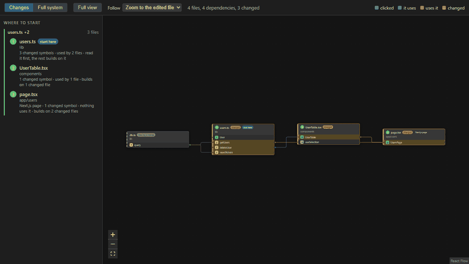
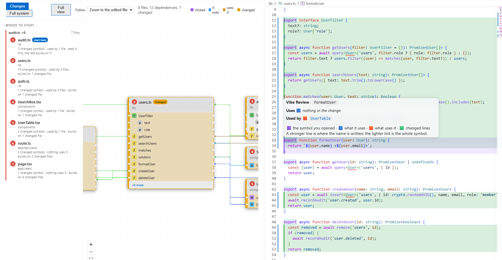
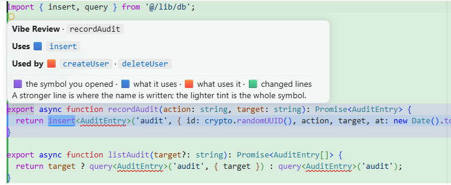
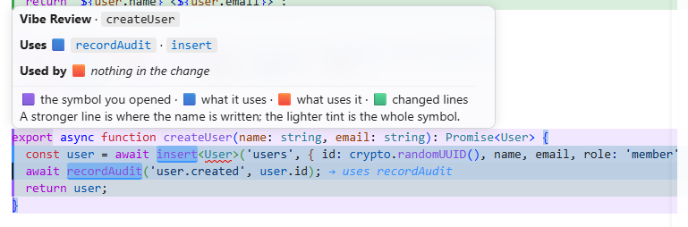

# Vibe Review

**Watch AI-written code appear as a live diagram, and always know where to start reviewing.**

Vibe Review is a VS Code extension that runs next to a coding agent (Claude Code, Copilot, Codex, or anything else that writes files). It reads your git changes and draws them as a class-diagram-like dependency graph: files as cards, symbols inside them, and arrows from the code that uses something to the code it uses. When the agent edits a file, its card lights up and the view follows it. When you want to read the code, one click opens it with the change and everything it touches marked in color.



<sub>The animation is the real webview playing a scripted sample session; no agent was involved. A file is created (placeholder card), the real card replaces it, and the view moves on to the next file being edited.</sub>

> **Status: alpha.** It works end to end for TypeScript, JavaScript and Next.js projects. Python and FastAPI are planned. Expect rough edges, and please open issues.

## From the graph to the code

The graph on the left, the code on the right. The cards are the changed files with the symbols inside them. The sidebar says where to start. The editor shows the symbol you clicked, the lines git reports as changed, and what that symbol uses and is used by.



Hovering the marked code shows what the symbol uses and what uses it. Each name is a link that jumps there and re-centers everything on it, so you can walk the route one step at a time.

| What a symbol is used by | What a symbol uses |
| --- | --- |
|  |  |

## What you get

- **A diagram of what changed.** Changed files plus the files they use and the files that use them. A *Full system* view shows the whole workspace, grouped into folder boxes: folders with changes are open, the others are collapsed into one card that you click to open.
- **Where to start.** The changed files are grouped into *features* (files that import each other). Each feature has its own reading order, a "start here" mark, numbered badges, and a one-line reason per file. Foundations come first.
- **Hover to see a route.** Hover a card or a symbol to light up everything it uses and everything that uses it, however many steps away. Rows that a collapsed card hides are shown while you hover.
- **Click to read the code.** Clicking a symbol opens the file beside the graph on the first changed line, with the symbol, the changed lines and the exact words that depend on it marked, each with a short label.
- **Live.** The graph refreshes when files change on disk. A file being written shows an "editing" indicator, a file that isn't in the diagram yet gets a placeholder card, and the view follows the edits. You can switch the follow to fit-all or off, and moving the view yourself pauses it until you press *Resume follow*.
- **Big files stay readable.** A large changed file shows only the symbols that changed. *Full view* opens everything.

### What the colors mean

| Color | Meaning |
| --- | --- |
| Purple | the symbol you opened |
| Blue | what it uses |
| Orange | what uses it |
| Green (in the editor) | lines git reports as changed |

In the editor the light tint covers the whole symbol; the stronger line and the highlighted word show where the name is written. The same legend is in the toolbar and in the hover card.

## Install and quick start

There is no Marketplace release yet, so you build the extension once and install it into your normal VS Code. After that it works on every project, like any other extension. You need **VS Code 1.90+** (with the `code` command on your PATH), **Node.js 22+** and **git**.

```bash
git clone https://github.com/mutabalShawandar/vibe-review.git
cd vibe-review
npm install
npm run install:vscode
```

Then:

1. Reload VS Code (or close and reopen it).
2. Open any git project that has uncommitted changes, or start your agent on it.
3. Press `Ctrl+Shift+P` / `Cmd+Shift+P` and run **Vibe Review: Open** (or click `Vibe Review: N changed` in the status bar).
4. Start with the card marked **start here** in the sidebar. Hover to see connections, click a symbol to read its code.

To update later, `git pull` and run `npm run install:vscode` again. To remove it, uninstall *Vibe Review* from the Extensions view. Want to hack on it instead? See *Run it from source* below.

## Run it from source

Use this to try changes without installing: it runs the extension from source in a separate VS Code development window. It takes about two minutes.

### Prerequisites

- **VS Code 1.90 or newer**, with the `code` command available in your terminal. (In VS Code: Command Palette → *Shell Command: Install 'code' command in PATH*. On Windows the installer already adds it.)
- **Node.js 22 or newer** and npm.
- **git** on your PATH.
- **A project to review**: a git repository with some uncommitted changes. Today the diagram understands TypeScript and JavaScript files (`.ts`, `.tsx`, `.js`, `.jsx`, and the `m`/`c` variants), so a Next.js or Node project is ideal.

### Quick start

```bash
git clone https://github.com/mutabalShawandar/vibe-review.git
cd vibe-review
npm install
npm run host -- "path/to/the/project/you/want/to/review"
```

`npm run host` builds the extension and opens a new VS Code window with it loaded, on the project you passed (other extensions are switched off in that window so they cannot interfere). In that window:

1. Make sure the project has uncommitted changes, or start your agent on it.
2. Open the Command Palette (`Ctrl+Shift+P` / `Cmd+Shift+P`) and run **Vibe Review: Open**. You can also click `Vibe Review: N changed` in the status bar.
3. The graph appears beside your editor. Keep it open while the agent works.

### Using it

- **Start with the sidebar.** *Where to start* lists the changed files, grouped into features, in reading order. Read the one marked **start here** first. Click an item to center its card and open the file.
- **Hover to see connections.** Hover a card or a symbol to light up everything it uses (blue) and everything that uses it (orange), however many steps away.
- **Click to read the code.** Clicking a symbol opens its file beside the graph on the first changed line. The symbol is purple, changed lines are green, and the exact words that depend on it are marked with a short label. Hover the marked code and click a name to jump along the route.
- **Let it follow the agent.** While files are written, their cards glow with an *editing* chip, a file that is not in the diagram yet gets a placeholder card, and the view moves along. Panning or zooming yourself pauses this; **Resume follow** takes you to the file being edited, or the last one that was.
- **The toolbar.** *Changes* shows what changed and its neighbors, *Full system* shows every file, grouped into one box per folder (a folder with a changed file starts open; click a box to open or close it). *Full view* opens every card (big changed files are collapsed to what changed). *Follow* chooses how the view follows edits: zoom to the edited file, fit all edited files, or off.

### Other ways to run it

- **From VS Code:** open this repository and press **F5** (the *Run Extension* configuration). If it complains that the extension host did not start in 10 seconds on a busy machine, press **Ctrl+Shift+B** instead (or run `npm run host`); it has no debugger attached.
- **While developing:** `npm run watch` rebuilds on every save; reload the development window (*Developer: Reload Window*) to pick up extension changes. Webview-only changes need just a close and reopen of the Vibe Review tab.
- **As an installable `.vsix`:** `npm run install:vscode` (see *Install and quick start*). A Marketplace release will come later.

### Troubleshooting

| Problem | Likely cause |
| --- | --- |
| "No changes found" | The folder is not a git repository, nothing is uncommitted, or the changed files are not TypeScript/JavaScript. Try **Full system**. |
| `code` is not recognized | The `code` command is not on your PATH; see the prerequisites. |
| No status bar item | git is missing, or the folder is not a git repository. |
| The graph shows only part of a multi-root workspace | Only the first workspace folder is analyzed for now. |
| The first open is slow on a big project | The first scan parses every file. Later refreshes only re-parse files that changed. |
| Editor marks are one line off after you edit | They are drawn from the last scan. Click the symbol again once the graph has refreshed. |

If something else goes wrong, open the **Output** panel and pick **Vibe Review**, then [open an issue](https://github.com/mutabalShawandar/vibe-review/issues) with what you see.

## How it works

1. **Changes** come from the git working tree (`git diff` plus untracked files), so any tool that writes files works. Nothing is specific to one agent.
2. **Parsing** uses tree-sitter (WASM). Each language is a strategy in `src/languages/<language>/` that reports symbols, imports, and where imported names are used. The core never mentions a language. Frameworks are a second strategy in `src/frameworks/<framework>/`: they detect which project folders use the framework (so monorepos work) and label notable files, such as a Next.js page or API route, with a chip on the card.
3. **The graph** is built in `src/core/`: import edges, symbol-to-symbol links, which symbols are relevant, and the review order (foundations first, then the files most others import).
4. **The UI** is a React app (React Flow for drawing, elkjs for layout) in `webview/`. For a framework that routes by file (Next.js), a *View* menu also offers a Routes view: the URL tree with the files of each route. What is drawn is chosen by a view renderer (`webview/src/views/`): Changes shows one card per file, and Full System puts files into folder boxes (`groups.ts` groups them, `layout.ts` lays the boxes out, then the files inside each open box). A new kind of view is one file plus one registry line. It only receives plain JSON, so it knows nothing about languages.

Usage detection is approximate: it matches imported names inside each symbol and does not model shadowing or dynamic access.

## Roadmap

- [x] TypeScript, JavaScript and Next.js
- [x] Framework strategies (Next.js first), so more frameworks can be added without touching the core
- [x] Live refresh, follow mode, review order, editor marks
- [ ] "Reviewed" checkmarks
- [ ] Python and FastAPI
- [ ] Optional Claude Code integration (hooks) for "files the agent is editing now" and "changes since the last prompt"
- [ ] Marketplace release

See [PLAN.md](PLAN.md) for the full design.

## Contributing

Contributions are welcome, especially new languages and frameworks. Read [CONTRIBUTING.md](CONTRIBUTING.md) first. The short version: fork the repository, work on a branch, and open a pull request; a new language is one folder, registered in one line, with tests. Commits follow [Conventional Commits](https://www.conventionalcommits.org/).

Run the checks before opening a pull request:

```bash
npm run typecheck
npm test
```

If Vibe Review is useful to you, a star on the repository helps other people find it.

## License

Vibe Review is open source under the [Apache License 2.0](LICENSE). Use it, change it and share it, personally or commercially. The license includes an explicit patent grant; see [NOTICE](NOTICE) for the copyright notice.

